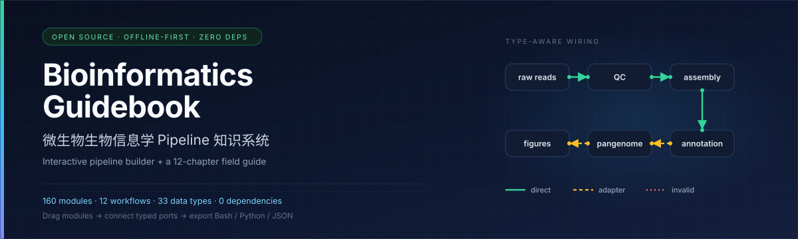
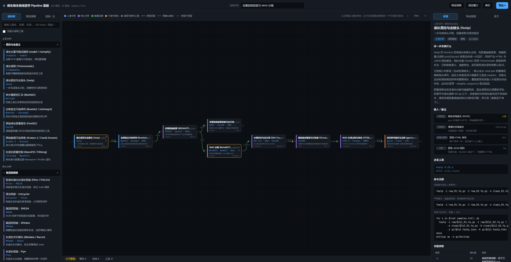

<p align="center">
  
</p>

<h1 align="center">Microbial Bioinformatics Pipeline Guidebook</h1>

<p align="center">
  An offline-first, data-driven knowledge base for microbial bioinformatics:<br>
  <strong>an interactive pipeline builder</strong> + <strong>a 12-chapter field guide</strong>
</p>

<p align="center">
  <a href="https://indigo-rain.github.io/bioinfo-guidebook/"><strong>Live demo »</strong></a>
  &nbsp;·&nbsp;
  <a href="docs/guidebook/00-overview-and-learning-path.md">Start reading</a>
  &nbsp;·&nbsp;
  <a href="docs/CONTRIBUTING.en.md">Contributing</a>
  &nbsp;·&nbsp;
  <a href="README.md">中文</a>
</p>

<p align="center">
  <a href="LICENSE"></a>
  <a href="LICENSE-docs"></a>
  <a href="#quick-start"></a>
  
  <a href="https://indigo-rain.github.io/bioinfo-guidebook/"></a>
</p>

<p align="center">
  
</p>

<p align="center">
  <sub>The panel after loading the "Metagenome assembly and MAG binning" preset: module palette, canvas, and the module inspector</sub>
</p>

> **Language note.** The guidebook is written in Chinese, with tool names, code, module IDs and file names kept in English. This README and [CONTRIBUTING.en.md](docs/CONTRIBUTING.en.md) are the English entry points. Translation contributions are welcome — see [Contributing](#contributing).

---

## Why this exists

In microbial bioinformatics, almost no analysis step is done by "one piece of software". What you actually do is stitch a dozen to several dozen tools together with shell and Python:

```
raw reads → QC → assembly → annotation → comparison → statistics → figures
   fastp    SPAdes   Bakta      Panaroo      pandas      ggplot2
```

That modular shape creates a specific failure mode: **the interfaces between tools are more error-prone than the tools themselves.**

- An off-by-one coordinate conversion from GFF to BED does not raise an error; it silently shifts every downstream interval by one base.
- A sample-name case mismatch can make a merge silently drop half the samples.
- A plotting module claims to pass a `dataframe` downstream, and a QC module claims to pass reads — both "type-check" against a target, yet neither module actually produces that data.

This repository puts two things side by side:

| | What it solves |
|---|---|
| **Interactive panel** | Draws *which modules, in what order, with what data flow* — and judges interface compatibility in real time |
| **Markdown guide** | Explains methodological trade-offs, parameter rationale and common pitfalls — not a tool catalogue |

Crucially, **both are derived from the same data registry**. Module descriptions, parameters, pitfalls and upstream/downstream relations in the panel all come from `data/modules/*.json`; rebuild after changing the data and both stay in sync. There is no second copy of the documentation to drift.

## Who it is for

- People new to microbial bioinformatics who need an **executable route**, not a list of tool names;
- Teams and labs that need to **standardise a pipeline** and write down interface conventions;
- Readers who want to understand *when to use A rather than B*, instead of memorising commands;
- Teachers building an **offline-distributable** course or internal knowledge base.

It is **not** for: anyone expecting a one-click analysis (the panel does not run analyses), or anyone expecting authoritative parameter defaults (always check the tool's official documentation).

## Highlights

- **160 modules**, each with typed input/output ports, parameter trade-offs, pitfalls, typical upstream/downstream modules and copyable command recipes.
- **Three-level edge validation**: 🟢 exact type match / 🟡 format needs confirmation / 🔴 cross-shape mismatch — with suggested adapter modules.
- **12 end-to-end workflows**: 16S, metagenome profiles, MAG binning, bacterial genomes, resistance/virulence, pangenomes, strain transmission, fungal ITS, viromes, RNA-seq and more.
- **Three exports**: pipeline JSON (re-importable), Bash and Python. Exports are structural skeletons with parameter starting points, not pretend production scripts.
- **Fully offline**: the panel is a single self-contained `index.html`; open it and go. The build scans the artifact for external links, `fetch()` and remote fonts, so "works offline" is machine-verified rather than promised.
- **Zero third-party dependencies**: build, tests and checks use only the Node.js standard library. No `npm install`.
- **Verifiable**: 48 unit tests, 12 workflows × 3 exports, strict build-time validation and CI.

## Try it online / offline

**Online:** <https://indigo-rain.github.io/bioinfo-guidebook/> (GitHub Pages)

**Offline:**

```bash
git clone https://github.com/Indigo-Rain/bioinfo-guidebook.git
cd bioinfo-guidebook
```

Then open `index.html` in any modern browser. No server, no network, no installation — it is a single ~1.4 MB HTML file that can be copied to any machine or archived with the project.

What the panel does:

1. **Drag modules** from the left palette onto the canvas; drag from a node's right-hand port to another node to connect them.
2. Validate each edge in real time; the "Issues" tab suggests adapter modules you can insert.
3. Load one of the **12 built-in workflows**, or start from a blank canvas.
4. Click any module to see its full description, parameter trade-offs, pitfalls and typical neighbours in the right-hand inspector.
5. Export **pipeline JSON** (re-importable), **Bash** or **Python**.

See [Chapter 0 · Overview and learning path](docs/guidebook/00-overview-and-learning-path.md) for a walkthrough (Chinese).

## By the numbers

| Dimension | Count |
|---|---:|
| Analysis modules | 160 |
| Category files | 20 |
| Data types | 33 |
| Analysis layers | 5 (upstream / core / data handling / visualisation / workflow engines) |
| End-to-end workflows | 12 |
| Tool declarations | 406 (262 unique tool names) |
| Parameter entries | 867 |
| Documented pitfalls | 1,048 |
| Code recipes | 300 |
| Guidebook | 12 chapters, ~6,400 lines |

## Quick start

### Read the guide

Start with [Chapter 0 · Overview and learning path](docs/guidebook/00-overview-and-learning-path.md). It has a "read by goal" table: 16S, single-genome, metagenome or comparative genomics — which chapters to read in which order.

### Rebuild after changing data

Requires **Node.js ≥ 18**; no third-party dependencies:

```bash
node tools/build.mjs --check    # validate only, write nothing
node tools/build.mjs            # validate + regenerate index.html and data/bundle.json
node tools/build.mjs --strict   # validate + verify guide/reference coverage (use before release)
node --test tools/tests/model.test.mjs
node tools/smoke-edge.mjs       # static artifact checks (browser probe depends on the environment)
```

The build is **deterministic**: rebuilding the same data produces byte-identical artifacts. CI checks that the committed `index.html` and `data/bundle.json` are in sync with the data registry.

## Repository layout

```text
bioinfo-guidebook/
├── index.html                 # Build artifact: self-contained interactive panel (~1.4 MB)
├── README.md / README.en.md   # Chinese / English README
├── LICENSE / LICENSE-docs     # Code: MIT; docs & data: CC BY 4.0
├── NOTICE                     # Third-party names, content sources, disclaimer
├── CITATION.cff               # Citation metadata
├── CHANGELOG.md
├── data/
│   ├── catalog.json           # Categories, analysis layers, data types
│   ├── module-manifest.json   # Authoritative module-ID list (the contract for feeds)
│   ├── modules/*.json         # 20 category files, 160 module entries (single source of truth)
│   ├── presets.json           # 12 end-to-end workflows
│   └── bundle.json            # Merged data (build artifact, for programmatic use)
├── docs/
│   ├── guidebook/             # 12 chapters (00–11, Chinese)
│   ├── reference/             # Module schema, tool index, parameter cheatsheet, troubleshooting, review
│   ├── assets/                # README banner and panel screenshot
│   ├── ARCHITECTURE.md        # System design and data model
│   ├── CONTRIBUTING.md        # How to add modules / presets / data types (Chinese)
│   ├── CONTRIBUTING.en.md     # English contributor guide
│   └── README.md              # Documentation index
├── assets/                    # Panel sources (inlined into index.html at build time)
│   ├── css/panel.css
│   ├── js/panel.js
│   └── templates/panel.html
├── tools/                     # Build, validation, tests and diagnostics (zero dependencies)
└── .github/                   # CI workflows, issue and PR templates
```

## Guidebook contents

The guide follows the same upstream → core → downstream structure as the panel. Every chapter covers: the question this layer must answer, what inputs/outputs and intermediate files look like, how to assemble tools (with decision trees), key parameter trade-offs, common pitfalls, and the corresponding panel module IDs.

| Chapter | Topic | What you get |
|---|---|---|
| [0](docs/guidebook/00-overview-and-learning-path.md) | Overview and learning path | A read-by-goal roadmap; how to use the panel |
| [1](docs/guidebook/01-environment-and-conventions.md) | Environment and project conventions | conda environments, directory layout, sample naming, database versioning |
| [2](docs/guidebook/02-upstream-qc.md) | Upstream QC | Adapters, low-quality bases, host depletion and contamination screening |
| [3](docs/guidebook/03-genome-assembly.md) | Genome assembly | Short/long/hybrid assembly trade-offs, k-mers, polishing and correction |
| [4](docs/guidebook/04-assembly-qc.md) | Assembly quality and contamination | N50/L50, BUSCO, CheckM2, contamination and chimera checks |
| [5](docs/guidebook/05-taxonomy-identification.md) | Taxonomy and species identification | ANI, 16S, Kraken2 and GTDB-Tk — where each one stops being valid |
| [6](docs/guidebook/06-annotation-resistance-virulence.md) | Annotation, resistance and virulence | Bakta/Prokka, RGI/CARD, VFDB, mobile genetic elements |
| [7](docs/guidebook/07-comparative-pangenome.md) | Comparative genomics and pangenomes | Core genomes, Panaroo, Roary, phylogenies and branch support |
| [8](docs/guidebook/08-metagenome-microbiome.md) | Metagenomics and microbiomes | Taxonomic/functional profiles, assembly, binning, MAG quality, amplicons |
| [9](docs/guidebook/09-transcriptome-differential-expression.md) | Transcriptomics and differential expression | rRNA depletion, alignment/counting, DESeq2/edgeR/limma model choices |
| [10](docs/guidebook/10-downstream-analysis-visualization.md) | Downstream analysis and visualisation | From tables to publication figures; colour, scale, error and reproducibility |
| [11](docs/guidebook/11-workflow-reproducibility.md) | Workflow engines and reproducibility | Snakemake/Nextflow, containers, version pinning and deliverables |

Reference documents (Chinese):

- [Module schema](docs/reference/module-schema.md) — the authoritative contract before writing a module;
- [Tool index](docs/reference/tool-index.md) — generated from the data;
- [Parameter cheatsheet](docs/reference/param-cheatsheet.md) — "when should I change this parameter?";
- [Troubleshooting](docs/reference/troubleshooting.md) — indexed by symptom;
- [Data quality review](docs/reference/quality-review.md) — adversarial review log and open verification items.

## Built-in workflows

| Workflow | Level | Steps | What it solves |
|---|---|---:|---|
| Core-genome alignment and phylogeny | Intermediate | 8 | Build a core-genome tree from annotated genomes and assess branch support |
| 16S amplicon: raw reads to community differences | Beginner | 9 | ASV denoising, taxonomy, diversity and community difference tests |
| Metagenome species and function profiles | Beginner | 9 | Read-based taxonomic and pathway profiles without assembly |
| Metagenome assembly and MAG binning | Advanced | 9 | Assembly, binning, refinement, quality assessment and taxonomy |
| Bacterial RNA-seq differential expression | Intermediate | 8 | rRNA depletion, alignment/counting, DE and enrichment |
| Bacterial genome: reads to species ID | Beginner | 8 | Assembly, quality, contamination checks and taxonomic identification |
| Resistance, virulence and mobile-element screening | Intermediate | 12 | Parallel database screening for resistance, virulence and plasmids |
| Pangenome construction and analysis | Intermediate | 7 | Core/accessory genes and pangenome saturation |
| Strain typing and transmission inference | Intermediate | 6 | SNP distance matrices and transmission clustering for outbreak work |
| QC metrics aggregation and project report | Beginner | 6 | Roll step logs into a project-level QC overview and report |
| Fungal ITS amplicon analysis | Intermediate | 6 | Community analysis tuned to the ITS region |
| Virome identification and quality assessment | Advanced | 8 | Identify viral sequences from metagenomes, assess completeness and quantify |

A preset is a **validated starting point**, not the only correct answer. After loading one you can freely add or remove modules and edges; alternative tools for the same step are separate modules, and the preset simply picks one.

## Design principles

### A single source of truth

`data/modules/*.json` is the only source. `index.html`, `docs/reference/tool-index.md` and the exporters are all derived from it. The only way to change the data is to edit those files and rebuild.

### Explicit upstream/downstream declarations, enforced by the build

Each module declares whom its output typically feeds, via `feeds`:

```json
"feeds": [
  { "target": "asm_spades", "viaType": "clean-reads", "note": "Cleaned reads go straight into assembly" }
]
```

The build enforces three constraints; any failure aborts:

1. `target` must be a real module ID (**no dangling references**);
2. `viaType` must be accepted by one of the target's input ports (**no invented interfaces**);
3. `viaType` must be a type the source module **actually produces** (**no claiming a data flow that does not exist**).

Constraint 3 was added after a subtle class of bug survived target-side validation: a plotting module claimed to pass a `dataframe` downstream, and a QC module claimed to pass reads. Both passed the target-side check while describing data the source never produced. Such edges guide users into meaningless connections in the panel.

### Data-type-driven edge validation

Compatibility is decided by each type's `shape`, not its name:

| Verdict | Condition | Rendering |
|---|---|---|
| `direct` | Exact type match | 🟢 solid green |
| `adapter` | One side is `any`, or same shape with a different type | 🟡 dashed amber |
| `invalid` | Different shapes | 🔴 dotted red |

`invalid` edges are **not blocked** — the panel lets you draw them and marks them red, while the "Issues" tab suggests adapter modules. Real analyses sometimes need unconventional conversions; the tool should not decide for you, but it must make the problem visible.

### One implementation shared by tests and the browser

`tools/lib/model.mjs` is a dependency-free pure-function module: Node tests `import` it directly, and the browser panel reuses the same source with `export` keywords stripped at build time. **There is no second implementation**, so "passes at build time but behaves differently at runtime" cannot happen by construction.

### Offline capability is machine-verified

`node tools/build.mjs` scans the **live code** of the artifact (after stripping HTML comments and inline JSON data) and rejects any external http(s) link, external `<script src>`, external `<link href>`, `fetch()`, `XMLHttpRequest` or remote font. The only exception is the SVG namespace identifier, which must appear exactly once, in `tools/lib/model.mjs`.

So the simplest offline check is: search for `http` in `index.html`; the only hit is that namespace constant.

See [docs/ARCHITECTURE.md](docs/ARCHITECTURE.md) for the full design (Chinese).

## Build and verify

| Command | Purpose | Current result |
|---|---|---|
| `node tools/build.mjs --check` | Validate data and existing artifacts, write nothing | 0 errors, 0 warnings |
| `node tools/build.mjs --strict` | Validate + rebuild + guide/reference coverage | Pass |
| `node --test tools/tests/model.test.mjs` | Unit tests | 48 / 48 pass |
| `node tools/verify-exports.mjs` | 12 workflows × 3 exports + edge cases | 16 / 16 pass |
| `node tools/diagnose-preset-edges.mjs` | Preset edge type diagnosis | 0 type errors |
| `node tools/audit-data.mjs` | Cross-file consistency audit | Pass (with a manual review list) |
| `node tools/smoke-edge.mjs` | Static artifact checks + browser render and runtime assertions | 14 / 14 pass (including a real browser render) |

CI runs the build, tests and export verification on Node.js 18, 20 and 22, and checks that the committed `index.html` and `data/bundle.json` match the data registry.

## Known limitations

**The panel does not run analyses.** It is a modelling and code-generation tool, not a replacement for analysis software or official documentation. Exported scripts are structural skeletons with parameter starting points; you must adapt paths and database versions.

**Versions need verification.** Each module's `provides[].version` is a series approximation of the form `major.minor.x`, not individually verified online. Known issues: 17 tools are written inconsistently across modules (e.g. SAMtools `1.1x` vs `1.21.x`), and 10 version fields are not version numbers at all. See the [quality review](docs/reference/quality-review.md) for the full list.

**Database versions matter more than software versions.** Reference databases, indexes and taxonomic models are not shipped in container images or conda environments; you must obtain and version them yourself (see [Chapter 1](docs/guidebook/01-environment-and-conventions.md)).

**Some modules are incomplete.** `asmqc_ideel` has `kind: template`: it provides inputs/outputs and decision criteria but does not pin a concrete command (the tool's entry point and parameters vary by release). The panel labels it as requiring project-specific adaptation.

**Browser rendering is automated; interactions are not.** `smoke-edge.mjs` launches a real Chromium/Edge instance and asserts the registry, module palette, preset loading, edge rendering and runtime errors (currently 14/14). Drag-and-drop, wiring and zooming still have no end-to-end tests. In environments where the browser cannot start, the script reports "skipped" or "failed" rather than pretending to pass.

**The type system is "good enough", not complete.** For example, rRNA sequences reuse `cds-fasta`, and shared modules output `any`. Such borrowings are documented in port `note` fields, but not eliminated at the type level.

**No semantic correctness checks.** The build guarantees that an edge type-checks; it cannot guarantee that the edge makes biological sense. That relies on judgement and review when writing modules.

## Contributing

This project is data-driven: contributions are mostly **data and documentation**, rarely code.

- Detailed guide: [docs/CONTRIBUTING.md](docs/CONTRIBUTING.md) (Chinese) / [docs/CONTRIBUTING.en.md](docs/CONTRIBUTING.en.md) (English)
- Content corrections: please include an **official documentation link** or reproducible evidence. Fixes to version numbers, defaults and output file names are especially welcome.
- New modules or workflows: read the [module schema](docs/reference/module-schema.md) first, and make `node tools/build.mjs --check` pass.

Before submitting:

```bash
node tools/build.mjs --strict
node --test tools/tests/model.test.mjs
node tools/verify-exports.mjs
node tools/diagnose-preset-edges.mjs
node tools/smoke-edge.mjs
```

## Citation

If this knowledge base helps your teaching or research, please cite:

```bibtex
@software{bioinfo_guidebook_2026,
  title   = {Microbial Bioinformatics Pipeline Guidebook},
  author  = {{Indigo-Rain and contributors}},
  year    = {2026},
  version = {1.0.0},
  url     = {https://github.com/Indigo-Rain/bioinfo-guidebook},
  license = {MIT}
}
```

Machine-readable metadata: [CITATION.cff](CITATION.cff).

## License

| Content | License |
|---|---|
| Source code (`tools/`, `assets/`, build scripts) | [MIT](LICENSE) |
| Documentation, data and figures (`docs/`, `data/`) | [CC BY 4.0](LICENSE-docs) |

`index.html` contains both code and explanatory text: treat the code as MIT and the text as CC BY 4.0. Third-party tool names and trademarks belong to their respective owners; see [NOTICE](NOTICE).

## Acknowledgements

This knowledge base stands on the work of many open-source tool authors and their documentation. Module descriptions, parameter trade-offs and pitfalls draw on official documentation, papers and general domain practice, then were edited and cross-checked for this project. Tool names and versions belong to their respective authors; this project is not affiliated with, or endorsed by, any documented tool.

**Content is provided "as is", without warranty of any kind.** Always verify against the official documentation for the exact release you use, and validate parameters and database versions on your own data.

---

<p align="center">
  If this project helps you, please consider giving it a ⭐<br>
  <sub>Made for people who have to make the pipeline actually work.</sub>
</p>
