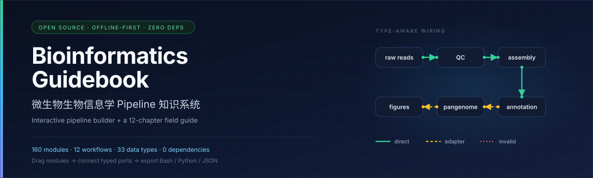
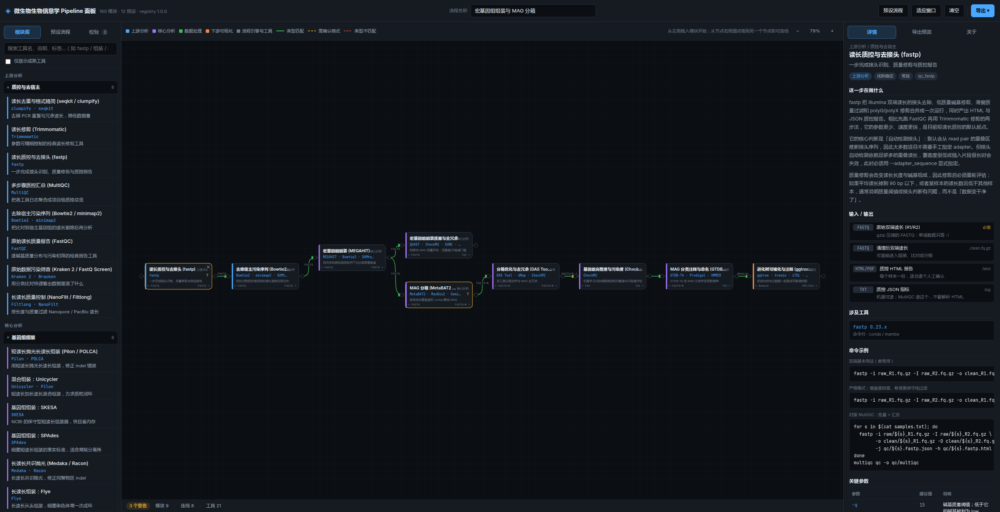

<p align="center">
  
</p>

<h1 align="center">微生物生物信息学 Pipeline 知识系统</h1>

<p align="center">
  离线可用、数据驱动的微生物生信知识库：<br>
  <strong>交互式 pipeline 拼装面板</strong> + <strong>12 章成体系指南</strong>
</p>

<p align="center">
  <a href="https://indigo-rain.github.io/bioinfo-guidebook/"><strong>在线体验面板 »</strong></a>
  &nbsp;·&nbsp;
  <a href="docs/guidebook/00-overview-and-learning-path.md">开始阅读指南</a>
  &nbsp;·&nbsp;
  <a href="docs/CONTRIBUTING.md">参与贡献</a>
  &nbsp;·&nbsp;
  <a href="README.en.md">English</a>
</p>

<p align="center">
  <a href="LICENSE"></a>
  <a href="LICENSE-docs"></a>
  <a href="#快速开始"></a>
  
  <a href="https://indigo-rain.github.io/bioinfo-guidebook/"></a>
  <a href="https://github.com/Indigo-Rain/bioinfo-guidebook/actions/workflows/verify.yml"></a>
</p>

<p align="center">
  
</p>

<p align="center">
  <sub>载入预设「宏基因组组装与 MAG 分箱」后的面板：左侧模块库、中间画布、右侧模块详情与参数取舍</sub>
</p>

---

## 为什么做这个

微生物生信里，几乎没有哪一步分析是「一个软件」完成的。你真正在做的事情，是把十几个到几十个工具用 shell 和 Python 拼起来：

```
原始读长 → 质控 → 组装 → 注释 → 比较 → 统计 → 图
   fastp    SPAdes  Bakta  Panaroo  pandas  ggplot2
```

这种「模块化拼接」的形态带来一个具体问题：**工具之间的接口比工具本身更容易出错**。

- GFF 到 BED 的坐标转换差一个碱基，不会报错，只会让下游所有区间偏移；
- 样本名的大小写不一致，会让合并在不报错的情况下丢掉一半样本；
- 绘图模块声称向下游传 `dataframe`，质控模块声称传读长——这些接口在类型上「说得通」，实际却没有任何数据流。

所以这个仓库把两件事放在一起：

| | 解决什么 |
|---|---|
| **交互式面板** | 把「用哪些模块、按什么顺序、数据怎么流」画清楚，并实时判定接口是否对得上 |
| **Markdown 指南** | 讲清每一步的方法学取舍、参数理由与常见坑，而不是罗列工具 |

关键在于：**两者由同一份数据注册表派生**。面板里的模块、说明、参数、坑与上下游关系，全部来自 `data/modules/*.json`；改了数据重新构建，两边一起更新。不存在「文档写的是一套、面板里是另一套」。

## 它适合谁

- 刚进入微生物生信，需要一条**可执行的路线**而不是一堆工具名的人；
- 要给团队或实验室**定标准流程**、需要把接口约定写下来的人；
- 想理解「什么时候用 A 而不是 B」、而不想背命令的人；
- 做教学、培训或内部知识库，需要可离线分发的材料的人。

它**不适合**：指望点一下就跑完分析的人（面板不执行分析），或需要权威参数默认值的人（请以工具官方文档为准）。

## 亮点

- **160 个模块**，每个都有输入 / 输出端口、参数取舍、常见坑、典型上下游与可复制的命令配方。
- **三档连线判定**：🟢 类型完全一致 / 🟡 需确认格式 / 🔴 跨数据结构，并给出可插入的适配器候选。
- **12 条端到端预设**：16S、宏基因组物种谱、MAG 分箱、细菌基因组、耐药与毒力、泛基因组、菌株传播、真菌 ITS、病毒组、RNA-seq 等。
- **三种导出**：管线 JSON（可回导）、Bash、Python。导出的是「结构骨架 + 参数起点」，不是假装能直接投产的脚本。
- **完全离线**：面板是单个自包含的 `index.html`，双击即用；构建期扫描产物中的外链、`fetch()`、远程字体，把「离线可用」变成机器验证的结论。
- **零第三方依赖**：构建、测试、校验全部只用 Node.js 标准库，不需要 `npm install`。
- **可验证**：48 项单元测试、12 条预设 × 3 种导出、构建期强校验与 CI。

## 在线体验与离线使用

**在线**：<https://indigo-rain.github.io/bioinfo-guidebook/>（GitHub Pages）

**离线**：

```bash
git clone https://github.com/Indigo-Rain/bioinfo-guidebook.git
cd bioinfo-guidebook
```

然后直接双击 `index.html`。不需要服务器、不需要联网、不需要安装任何东西——它就是一个约 1.4 MB 的 HTML 文件，可以拷到任何机器上打开，也可以随项目一起归档。

面板能做什么：

1. 从左侧**拖模块进画布**，从节点右侧圆点拖到另一个节点即建立连线；
2. 实时校验连线是否合法，并在「校验」标签给出可插入的适配器候选；
3. 载入 12 条**预设流程**，或从空白开始自己拼；
4. 点击任意模块，在右栏查看它的完整说明、参数取舍、常见坑与典型上下游；
5. 导出**管线 JSON**（可再导入）、**Bash 脚本**、**Python 脚本**。

更细的使用说明见 [第 0 章 · 总览与学习路径](docs/guidebook/00-overview-and-learning-path.md)。

## 内容规模

| 维度 | 数量 |
|---|---:|
| 分析模块 | 160 |
| 分类文件 | 20 |
| 数据类型 | 33 |
| 分析层 | 5（上游 / 核心 / 数据处理 / 下游可视化 / 流程引擎） |
| 端到端预设流程 | 12 |
| 工具声明 | 406 条（262 个去重工具名） |
| 参数条目 | 867 |
| 常见坑 | 1,048 |
| 可复制命令配方 | 300 |
| 指南正文 | 12 章，约 6,400 行 |

## 快速开始

### 读指南

从 [第 0 章 · 总览与学习路径](docs/guidebook/00-overview-and-learning-path.md) 开始。它有一张「按目标选读」的路径表：做 16S、做单菌基因组、做宏基因组、做比较基因组，分别该读哪几章。

### 重新构建（改了数据之后）

需要 **Node.js ≥ 18**，零第三方依赖：

```bash
node tools/build.mjs --check    # 只校验，不写文件
node tools/build.mjs            # 校验 + 重新生成 index.html 与 data/bundle.json
node tools/build.mjs --strict   # 校验并确认指南/参考文档覆盖完整（交付前用）
node --test tools/tests/model.test.mjs
node tools/smoke-edge.mjs       # 产物静态检查（浏览器渲染项视环境而定）
```

构建是**确定性**的：同一份数据重复构建，产物字节级一致。CI 会核对 `index.html` 与 `data/bundle.json` 是否与数据同步。

## 仓库结构

```text
bioinfo-guidebook/
├── index.html                 # 构建产物：自包含的交互式面板（约 1.4 MB）
├── README.md / README.en.md   # 中文 / 英文说明
├── LICENSE / LICENSE-docs     # 代码 MIT；文档与数据 CC BY 4.0
├── NOTICE                     # 第三方工具名称、内容来源与免责说明
├── CITATION.cff               # 学术引用元数据
├── CHANGELOG.md
├── data/
│   ├── catalog.json           # 分类、分析层、数据类型的定义
│   ├── module-manifest.json   # 模块 id 的权威清单（feeds 的事前契约）
│   ├── modules/*.json         # 20 个分类文件，160 个模块条目（唯一数据源）
│   ├── presets.json           # 12 条端到端预设流程
│   └── bundle.json            # 合并后的数据（构建产物，供程序化消费）
├── docs/
│   ├── guidebook/             # 12 章论述层文档（00–11）
│   ├── reference/             # 模块规范、工具索引、参数速查、故障排查、质量审查
│   ├── assets/                # README 横幅与面板截图
│   ├── ARCHITECTURE.md        # 系统设计与数据模型
│   ├── CONTRIBUTING.md        # 如何新增模块 / 预设 / 数据类型（中文）
│   ├── CONTRIBUTING.en.md     # English contributor guide
│   └── README.md              # 文档索引
├── assets/                    # 面板的源文件（构建时内联进 index.html）
│   ├── css/panel.css
│   ├── js/panel.js
│   └── templates/panel.html
├── tools/                     # 构建、校验、测试与诊断脚本（零依赖）
└── .github/                   # CI 工作流、Issue / PR 模板
```

## 指南目录

指南按「上游 → 核心 → 下游」组织，与面板的分层一致。每章都有固定的结构：这一层要回答什么问题、输入输出长什么样、工具拼装思路、关键参数取舍、常见坑、与面板模块 id 的对应关系。

| 章节 | 主题 | 你会得到什么 |
|---|---|---|
| [第 0 章](docs/guidebook/00-overview-and-learning-path.md) | 总览与学习路径 | 按目标选读的路线图；面板使用方法 |
| [第 1 章](docs/guidebook/01-environment-and-conventions.md) | 环境与工程规范 | conda 环境、目录约定、样本命名、数据库版本管理 |
| [第 2 章](docs/guidebook/02-upstream-qc.md) | 上游数据质控 | 接头、低质量碱基、宿主污染与污染筛查的判断依据 |
| [第 3 章](docs/guidebook/03-genome-assembly.md) | 基因组组装 | 短读长/长读长/混合组装的取舍、k-mer、抛光与纠错 |
| [第 4 章](docs/guidebook/04-assembly-qc.md) | 组装质量与污染评估 | N50/L50、BUSCO、CheckM2、污染与嵌合体的判定 |
| [第 5 章](docs/guidebook/05-taxonomy-identification.md) | 分类鉴定与物种注释 | ANI、16S、Kraken2、GTDB-Tk 的适用边界 |
| [第 6 章](docs/guidebook/06-annotation-resistance-virulence.md) | 功能注释、耐药与毒力 | Bakta/Prokka、RGI/CARD、VFDB、可移动元件 |
| [第 7 章](docs/guidebook/07-comparative-pangenome.md) | 比较基因组与泛基因组 | 核心基因组、Panaroo、ROARY、系统发育树与支持度 |
| [第 8 章](docs/guidebook/08-metagenome-microbiome.md) | 宏基因组与微生物组 | 物种/功能谱、组装、分箱、MAG 质量、扩增子 |
| [第 9 章](docs/guidebook/09-transcriptome-differential-expression.md) | 转录组与差异表达 | 去 rRNA、比对计数、DESeq2/edgeR/limma 的模型选择 |
| [第 10 章](docs/guidebook/10-downstream-analysis-visualization.md) | 下游分析与可视化 | 从表格到可发表图形；颜色、比例、误差与可复现性 |
| [第 11 章](docs/guidebook/11-workflow-reproducibility.md) | 工作流引擎与可重复性 | Snakemake/Nextflow、容器、版本锁定与交付物 |

参考文档：

- [模块条目规范](docs/reference/module-schema.md)——写模块前的权威契约；
- [工具索引](docs/reference/tool-index.md)——由数据生成的工具清单；
- [参数速查表](docs/reference/param-cheatsheet.md)——「这个参数什么时候该改」；
- [错误与故障排查](docs/reference/troubleshooting.md)——按问题现象索引；
- [数据质量审查](docs/reference/quality-review.md)——对抗式复核记录与仍待核对项。

## 内置预设流程

| 预设 | 难度 | 步骤 | 解决的问题 |
|---|---|---:|---|
| 核心基因组比对与系统发育树 | 进阶 | 8 | 从已注释基因组构建核心基因组树并评估分支支持度 |
| 16S 扩增子：从原始读长到群落差异 | 入门 | 9 | ASV 去噪、物种注释、多样性与群落差异检验 |
| 宏基因组物种与功能谱 | 入门 | 9 | 不依赖组装，直接从读长得到物种组成与通路谱 |
| 宏基因组组装与 MAG 分箱 | 高阶 | 9 | 组装、分箱、优化、质量评估到分类注释 |
| 细菌转录组差异表达 | 进阶 | 8 | 去 rRNA、比对计数到差异表达与富集 |
| 细菌基因组：从读长到物种鉴定 | 入门 | 8 | 组装、质量评估、污染检验到分类学鉴定 |
| 细菌基因组：耐药、毒力与可移动元件筛查 | 进阶 | 12 | 多数据库并行筛查耐药、毒力与质粒 |
| 泛基因组构建与分析 | 进阶 | 7 | 核心/附属基因与泛基因组饱和趋势 |
| 菌株分型与传播关系推断 | 进阶 | 6 | SNP 距离矩阵与传播聚类，用于暴发调查 |
| 质控指标汇总与项目报告 | 入门 | 6 | 把各步骤日志汇总成项目级质控总览 |
| 真菌 ITS 扩增子分析 | 进阶 | 6 | 针对 ITS 区域特点的真菌群落分析 |
| 病毒组识别与质量评估 | 高阶 | 8 | 从宏基因组中识别病毒序列、评估完整度并定量 |

预设是**经过验证的起点**，不是唯一正确答案。载入后可以自由增删模块与连线；同一环节的候选工具是各自独立的模块，预设只是选了其中一种。

## 设计要点

### 单一数据源

`data/modules/*.json` 是唯一数据源。`index.html`、`docs/reference/tool-index.md` 与导出脚本都由它派生。改变数据的唯一方式就是改它，然后重新构建。

### 显式声明上下游，并强制校验

每个模块用 `feeds` 显式声明「它的输出通常喂给谁」：

```json
"feeds": [
  { "target": "asm_spades", "viaType": "clean-reads", "note": "清理后的读长直接进入组装" }
]
```

构建会强制三条约束，任一条不过即失败：

1. `target` 必须是真实存在的模块 id（**悬空引用会使知识图断链**）；
2. `viaType` 必须能被 `target` 的输入端口接受（**接口不能凭空假设**）；
3. `viaType` 必须是**本模块自己真实产出**的类型（**不能声称一条不存在的数据流**）。

第 3 条是实践中发现的必要补充：只校验目标侧会放过一类隐蔽错误——绘图模块声称向下游传 `dataframe`、质控模块声称传读长，这些都能通过目标侧校验，却描述了一个模块根本没产出的数据。

### 数据类型驱动的连线判定

连线是否合法由数据类型的 `shape` 决定，不看名字：

| 判定 | 条件 | 呈现 |
|---|---|---|
| `direct` | 类型完全一致 | 🟢 绿色实线 |
| `adapter` | 有一方是 `any`，或同 shape 不同 type | 🟡 黄色虚线 |
| `invalid` | 跨 shape | 🔴 红色点线 |

`invalid` 不会被阻止——面板允许连上并标红，同时在「校验」标签给出候选适配器。分析流程有时确实需要非常规转换，工具不该替人做决定，但必须让问题可见。

### 测试与面板共用同一份实现

`tools/lib/model.mjs` 是零依赖的纯函数模块：Node 测试直接 `import` 它，浏览器面板通过构建时剥离 `export` 关键字复用同一份源码。**不存在两份实现**，因此不会出现「构建期校验通过但运行期行为不同」。

### 完全离线是被机器验证的

`node tools/build.mjs` 会扫描产物的**活代码**（剥离 HTML 注释与内联 JSON 数据），不允许出现任何外部 http(s) 链接、外链 `<script src>`、外链 `<link href>`、`fetch()`、`XMLHttpRequest` 或远程字体。唯一的例外是 SVG 命名空间标识符，且它只允许在 `tools/lib/model.mjs` 中出现一次。

因此你可以用最朴素的方式验证离线可用性：在 `index.html` 里搜索 `http`，唯一命中的就是那一行命名空间常量。

更完整的设计说明见 [docs/ARCHITECTURE.md](docs/ARCHITECTURE.md)。

## 构建与验证

| 命令 | 作用 | 当前结果 |
|---|---|---|
| `node tools/build.mjs --check` | 校验数据与现有产物，不写文件 | 0 错误、0 警告 |
| `node tools/build.mjs --strict` | 校验 + 重建 + 指南/参考文档覆盖检查 | 通过 |
| `node --test tools/tests/model.test.mjs` | 单元测试 | 48 / 48 通过 |
| `node tools/verify-exports.mjs` | 12 条预设 × 3 种导出 + 边界情况 | 16 / 16 通过 |
| `node tools/diagnose-preset-edges.mjs` | 预设连线类型诊断 | 0 条类型错误 |
| `node tools/audit-data.mjs` | 跨文件一致性审计 | 通过（含人工复核清单） |
| `node tools/smoke-edge.mjs` | 产物静态检查 + 浏览器渲染与运行时断言 | 14 / 14 通过（含真实浏览器渲染） |

CI 在 Node.js 18 / 20 / 22 上运行构建、测试与导出校验，并检查提交的 `index.html` 与 `data/bundle.json` 是否与数据同步。

## 已知限制

**面板不运行分析。** 它是建模与代码生成工具，不替代任何分析软件，也不替代工具官方文档。导出的脚本是「结构骨架 + 参数起点」，必须按你的数据路径与数据库版本改写。

**版本号需核对。** 各模块的 `provides[].version` 写的是「主.次.x」形式的系列号，未联网逐个核对。已知有 17 个工具在不同模块里的版本写法不一致（如 SAMtools `1.1x` vs `1.21.x`）、10 条 version 不是版本号。完整清单与待核对项见 [质量审查记录](docs/reference/quality-review.md)。

**数据库版本比软件版本更重要。** 参考数据库、索引、分类模型都不在镜像与 conda 环境里，需要单独管理版本（见 [第 1 章](docs/guidebook/01-environment-and-conventions.md)）。

**个别模块尚不完整。** `asmqc_ideel` 的 `kind` 为 `template`：它给出输入输出与判定思路，但未固化具体调用命令（该工具的入口与参数随版本变化较大）。面板会明确标注「需按项目改写」。

**浏览器渲染已自动化，但交互仍未覆盖。** `smoke-edge.mjs` 会启动真实 Chromium/Edge，断言注册表、模块库、预设载入、连线渲染与运行时错误（当前 14 项全过）。但拖拽、连线、缩放等鼠标交互仍没有端到端测试；在无法启动浏览器的环境中，脚本会报告「跳过」或「失败」，而不是谎报通过。

**类型体系是「够用」而非完备。** 例如 rRNA 序列复用 `cds-fasta` 承载，共用型模块用 `any` 输出。这类借用都在端口 `note` 里写明了，但没有从类型层面消除。

**不做语义正确性检查。** 构建能保证「这条边类型对得上」，不能保证「这条边在生物学上合理」。后者依赖写模块时的判断与评审。

## 参与贡献

这个项目是数据驱动的，贡献主要是**补数据**与**补文档**，很少需要改代码。

- 中文指南：[docs/CONTRIBUTING.md](docs/CONTRIBUTING.md)
- English guide：[docs/CONTRIBUTING.en.md](docs/CONTRIBUTING.en.md)
- 内容纠错：请附上**官方文档链接**或可复现的证据；版本号、默认值、输出文件名的修正尤其欢迎。
- 新模块 / 新预设：请先读 [模块条目规范](docs/reference/module-schema.md)，并跑通 `node tools/build.mjs --check`。

提交前请运行：

```bash
node tools/build.mjs --strict
node --test tools/tests/model.test.mjs
node tools/verify-exports.mjs
node tools/diagnose-preset-edges.mjs
node tools/smoke-edge.mjs
```

## 引用

如果这个知识系统对您的教学或研究有帮助，请引用：

```bibtex
@software{bioinfo_guidebook_2026,
  title   = {Microbial Bioinformatics Pipeline Guidebook},
  author  = {{Indigo-Rain and contributors}},
  year    = {2026},
  version = {1.0.0},
  url     = {https://github.com/Indigo-Rain/bioinfo-guidebook},
  license = {MIT}
}
```

机器可读的元数据见 [CITATION.cff](CITATION.cff)。

## 许可证

| 内容 | 许可证 |
|---|---|
| 源代码（`tools/`、`assets/`、构建脚本） | [MIT](LICENSE) |
| 文档、数据与图表（`docs/`、`data/`） | [CC BY 4.0](LICENSE-docs) |

`index.html` 同时包含代码与说明文字：代码按 MIT、文字按 CC BY 4.0 处理。第三方工具名称与商标归各自所有者，详见 [NOTICE](NOTICE)。

## 致谢

这个知识系统建立在大量开源工具作者与公开文档之上。模块说明、参数取舍与常见坑参考了各工具的官方文档、论文与领域通用实践，并经过本项目的编辑与交叉核对。工具名称与版本归各自作者所有；本项目与任何被记录的工具均无隶属或背书关系。

**内容按「现状」提供，不附带任何担保。** 使用前请以工具官方文档为准，并在自己的数据上验证参数与数据库版本。

---

<p align="center">
  如果这个项目对你有帮助，欢迎点一个 ⭐<br>
  <sub>Made for people who have to make the pipeline actually work.</sub>
</p>
